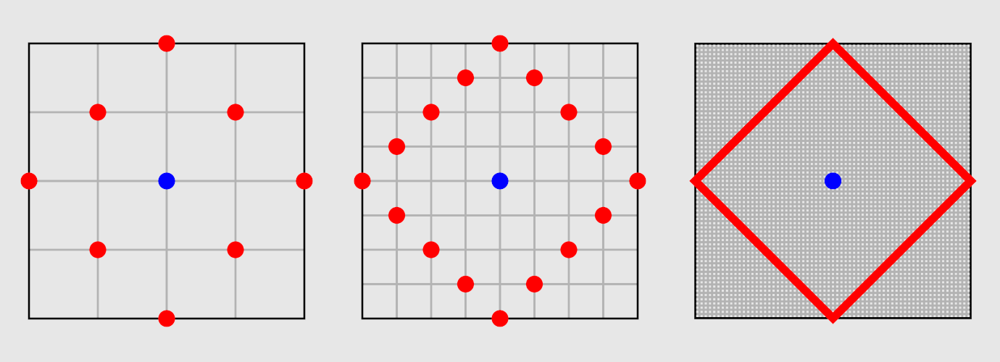

## Part 1

Another day, another grid puzzle. In fact, it's some sort of strange race where
we're allowed to _cheat_ by phasing through the walls. We might just have a
winning chance here, but we have to choose our cheats wisely.

First, let's read the map of the racetrack in a way our program can understand.
The way I do this for Advent of Code is with a custom [`grids` module](https://github.com/WinslowJosiah/adventofcode/tree/main/solutions/utils/grids.py);
read my writeups for Days [4](/solutions/2024/day/4), [6](/solutions/2024/day/6),
[8](/solutions/2024/day/8), [10](/solutions/2024/day/10), [12](/solutions/2024/day/12),
[15](/solutions/2024/day/15), [16](/solutions/2024/day/16), and [18](/solutions/2024/day/18)
to see how it works in more detail.

In our case, we want to ignore the wall (`#`) tiles, so that checking whether we
can visit a tile is as easy as checking whether it exists in our grid. And once
we have our grid, we can find the start and end points with `next()` and some
simple generator expressions.

```py title="2024\day20\solution.py"
class Solution(StrSplitSolution):
    def part_1(self) -> int:
        grid = parse_grid(self.input, ignore_chars="#")
        start = next(k for k, v in grid.items() if v == "S")
        end = next(k for k, v in grid.items() if v == "E")
        ...
```

Next, let's find the path from the start to the end -- and record each tile's
distance along the path, so we can calculate our time savings later.

We are assured that the path is unique, so we can start at the starting tile (at
distance 0) and keep travelling to the next valid neighboring tile (increasing
the distance by 1) until we reach the end. (My `grids` module has a `neighbors`
function to get neighboring tiles; we'll want to travel to an unvisited neighbor
that's still in the grid, which we can choose with `next()` because we're
assured there's only one.)

```py title="2024\day20\solution.py"
class Solution(StrSplitSolution):
    def part_1(self) -> int:
        ...
        # Find the distances of all tiles from the start
        # NOTE This assumes there is only one path to the end.
        distances = {start: 0}
        loc = start
        while loc != end:
            # Move to the next neighbor that's in the grid and that
            # hasn't yet been visited
            new_loc = next(
                n for n in neighbors(loc, num_directions=4)
                if n in grid and n not in distances
            )
            # We've moved forward by one tile
            distances[new_loc] = distances[loc] + 1
            loc = new_loc
        ...
```

Finally, let's do the important part: counting all the best cheats. We're only
allowed to consider cheats between tiles with a "[taxicab distance](https://en.wikipedia.org/wiki/Taxicab_geometry)"
-- i.e. grid-based distance, where only movements along grid lines are allowed
-- of 2 or less. My `grids` module has a `taxicab_distance` function for this,
and the formula is rather simple:

```py title="utils\grids.py"
type GridPoint = tuple[int, int]
...

def taxicab_distance(a: GridPoint, b: GridPoint) -> int:
    return abs(a[0] - b[0]) + abs(a[1] - b[1])
```

So all the _potential_ cheats would simply be all pairs of tiles with a taxicab
distance of 2 or less;[^all-pairs] we'll want to tally up all potential cheats
where this taxicab distance saves at least 100 picoseconds over the normal
distance (i.e. the difference between the recorded path distances for both
tiles).

[^all-pairs]: The way I get every pair of tiles is a bit redundant; some of the
pairs will have two of the same tile (so using the cheat would _not help_), and
some of the pairs will have tiles `a` and `b` in reverse path order (so using
the cheat would actively _hurt_). However, this doesn't affect our answer,
because these unhelpful cheats are filtered out by the "good" cheats check.

```py title="2024\day20\solution.py"
class Solution(StrSplitSolution):
    def part_1(self) -> int:
        ...
        # A potential cheat is a cheat within the allowed length
        potential_cheats = (
            (a, b)
            for a in distances.keys()
            for b in distances.keys()
            if taxicab_distance(a, b) <= 2
        )
        # A good cheat is a cheat that saves at least 100 picoseconds
        # over travelling on the path normally
        num_good_cheats = sum(
            1
            for a, b in potential_cheats
            if taxicab_distance(a, b) <= distances[b] - distances[a] - 100
        )
        return num_good_cheats
```

:::tip
Let's say you want to count the number of items in a collection that fit some
condition. There are a few different ways to do this, but one of the [easiest](https://pep20.org/#easy)
ways is using `sum()` to add up a `1` for each item you want to count. For
example, to count the even numbers in a sequence of numbers, you can do
`sum(1 for n in seq if n % 2 == 0)`. (This works even if you can't call `len()`
on your sequence, e.g. if it's a generator.)

I use this technique above to count the number of "good" time-saving cheats.
It's a useful idiom to know.
:::

This is good enough to get an answer; however, it takes about 8 seconds on my
machine, which tells me that I'm doing something inefficiently. Let's worry
about that in Part 2.

## Part 2

The only thing that's changed in Part 2 is the allowed cheat length, so let's
first factor out our entire solution into a function with a `cheat_length`
parameter.

```py title="2024\day20\solution.py" ins={2,14,16-17} ins=/<= (cheat_length)/
class Solution(StrSplitSolution):
    def _solve(self, cheat_length: int) -> int:
        ... # Part 1 code from before
        # A potential cheat is a cheat within the allowed length
        potential_cheats = (
            (a, b)
            for a in distances.keys()
            for b in distances.keys()
            if taxicab_distance(a, b) <= cheat_length
        )
        ... # More Part 1 code from before

    def part_1(self) -> int:
        return self._solve(cheat_length=2)

    def part_2(self) -> int:
        return self._solve(cheat_length=20)
```

In fact, if all we want is to _eventually_ get an answer, we're done! But that
takes about 16 seconds on my machine, and I think we can do much better than
that. So how can we speed up our search of cheats?

At the moment, we're looking at _all_ possible pairings of start and end tiles,
and then filtering them down to pairings within the allowed cheat length. But if
you think about it, it doesn't make sense to check _all_ of those pairings; once
we have a possible start tile, the only possible end tiles will be the tiles
within our required distance from that start tile. In fact, all the end tiles
will just be all tiles within a "circle"[^circle-vs-disk] of the start tile --
though in the "taxicab geometry" we're working in, a "circle" looks more like a
tilted square.

:::image-figure[In taxicab geometry, these figures are "circles" -- all points at the same "distance" from a center point. :br :small[_(Image modified from the [Wikimedia Commons](https://commons.wikimedia.org/wiki/File:TaxicabGeometryCircle.svg).)_]]

:::

[^circle-vs-disk]: Technically, because we want both the boundary points _and_
the interior points of this "circle", what we want is actually called a "disk".
The only problem is, I can't find a good visualization of this kind of object by
Googling "taxicab geometry disk"... so just _imagine_ that all the interior
points in those images are filled in as well.

Let's write a function for this; we can have it iterate through all points
within a given "radius" of a given center point. My custom `grids` module
includes a helpful `add_points` function to add `GridPoint`s (i.e. tile
locations) together, so we can just choose `dx`/`dy` pairs where the distance
from `(0, 0)` -- that is, `abs(dx) + abs(dy)` -- is at most our radius, and add
those `dx`/`dy` pairs to our center point. Here's an unfinished sketch of what
this function would look like.

```py title="2024\day20\solution.py" "..."
from collections.abc import Iterator

def points_within_radius(
        center: GridPoint,
        radius: int,
) -> Iterator[GridPoint]:
    """
    Yield all points within a given radius of the center point (by
    taxicab distance).
    """
    for dx in range(-radius, radius + 1):
        # TODO Choose max_dy so that abs(dx) + abs(dy) <= radius
        max_dy = ...
        for dy in range(-max_dy, max_dy + 1):
            yield add_points(center, (dx, dy))
```

We're looping `dx` from `-radius` to `radius`, and `dy` from `-max_dy` to
`max_dy`... but what is `max_dy`? Simply put, `max_dy` should be whatever we'd
need to add to `abs(dx)` to get a distance of `radius` -- in other words, it
should be `radius - abs(dx)`. Not difficult at all!

```py title="2024\day20\solution.py" ins="radius - abs(dx)"
from collections.abc import Iterator

def points_within_radius(
        center: GridPoint,
        radius: int,
) -> Iterator[GridPoint]:
    """
    Yield all points within a given radius of the center point (by
    taxicab distance).
    """
    for dx in range(-radius, radius + 1):
        max_dy = radius - abs(dx)
        for dy in range(-max_dy, max_dy + 1):
            yield add_points(center, (dx, dy))
```

We'll use this function to limit our choices for `b` points of potential cheats
once we have an `a` point. If we think of `distances.keys()` (our path points)
and `points_within_radius(a, cheat_length)` (the points within our "circle") as
sets of points, we can use the `&` (set intersection) operator to get the points
in common between both of those sets -- i.e. the points that are both on our
path _and_ within our "circle".

```py title="2024\day20\solution.py" del={10-11} ins={12}
...

class Solution(StrSplitSolution):
    def _solve(self, cheat_length: int) -> int:
        ...
        # A potential cheat is a cheat within the allowed length
        potential_cheats = (
            (a, b)
            for a in distances.keys()
            for b in distances.keys()
            if taxicab_distance(a, b) <= cheat_length
            for b in distances.keys() & points_within_radius(a, cheat_length)
        )
        ...
```

:::attention
[Set operators](https://docs.python.org/3/builtins/stdtypes.html#set-types-set-frozenset)
such as `&` normally require both operands to be `set`s -- not just generic
collections of objects, but instances of the `set` type. If you want to do these
operations to things other than sets, the usual approach is to use the
non-operator versions of these operations such as [`set.intersection()`](https://docs.python.org/3/builtins/stdtypes.html#frozenset.intersection).

In this case, though, _neither_ of the sets of points we're dealing with are
properly `set`s; one is a ["dictionary view"](https://docs.python.org/3/builtins/stdtypes.html#dictionary-view-objects),
and the other is a ["generator iterator"](https://docs.python.org/3/builtins/stdtypes.html#generator-iterators).
But a "dictionary view" object is enough like a `set` that set operators work
just as well with them; in fact, the other operand doesn't even have to be a
`set` for the set operators to work!
:::

This change brings the total time down to ~1.85 seconds on my machine. Far from
picosecond-level fast like the puzzle prompt describes, but _definitely_ an
improvement.
